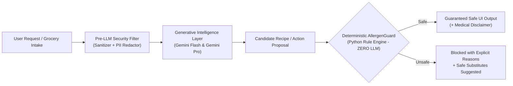

# PlateWise Architecture Specification

## 1. System Philosophy: Probabilistic Reasoning vs Deterministic Safety

The fundamental architectural principle of PlateWise is the strict segregation of **probabilistic generative reasoning** from **deterministic safety enforcement**:

The Large Language Model is utilized for what it excels at: multimodal vision parsing, natural language comprehension, culinary creativity, and multilingual dialogue. However, **the LLM is never permitted to make the final determination on food safety or allergens**. The deterministic `AllergenGuard` has absolute veto authority.

---

## 2. Agent Inventory & Scoped Permissions

| Agent | Model / Engine | Scoped Capabilities | Security Boundary |
| :--- | :--- | :--- | :--- |
| **`OrchestratorAgent`** | Gemini Flash / Fast Dispatch | Intent parsing, context coordination, Human-In-The-Loop gate. | Cannot mutate database without client approval payload. |
| **`IntakeAgent`** | Gemini 2.5 Flash Multimodal | Multimodal vision OCR, receipt parsing, barcode extraction. | Read-only input; produces structured proposals. |
| **`ShelfLifeAgent`** | Deterministic Python Rules | Baseline shelf-life lookup, spoilage scoring, "Use First" priority. | Strictly deterministic calculations. |
| **`MealPlannerAgent`** | Gemini 2.5 Pro | Complex multi-day culinary planning, nutritional balancing. | Output intercepted by AllergenGuard before display. |
| **`AllergenGuard`** | Deterministic Python Taxonomy | Word token containment, cross-reactivity mapping, dietary rule logic. | **Non-probabilistic code.** Absolute veto authority. |
| **`SurplusMatchAgent`** | Haversine Geo Engine + Firestore | Distance calculation, pickup slot allocation, atomic claim locking. | Atomic Firestore transaction prevents double-claim race. |
| **`FoodSafetyAgent`** | Curated RAG + Gemini Flash | USDA FoodKeeper & FSSAI regulatory compliance assessments. | Fast-path deterministic rule engine for known danger zones. |
| **`InsightsAgent`** | BigQuery ML / SQL Aggregator | Sustainability metrics ($kg$, $CO_2e$, INR), ARIMA_PLUS waste forecast. | Read/Write access strictly to analytical tables. |

---

## 3. Data Flow & Transaction Lifecycle

### 3.1 Smart Intake Flow
1. User provides receipt text, photo, or barcode.
2. `SecuritySanitizer` scans for prompt injection vectors.
3. `PIIRedactor` strips personal phone numbers, emails, and names.
4. `IntakeAgent` invokes Gemini Flash with `FoodIntakeResponse` schema.
5. Items with confidence $< 0.85$ are flagged with `needs_user_confirmation=True`.
6. Client displays Human-In-The-Loop review modal; on confirmation, items commit to Firestore.

### 3.2 Safe Meal Planning Flow
1. User requests meal plan for active inventory.
2. `MealPlannerAgent` pulls active items sorted by `use_first_score` descending.
3. User profile allergens (e.g. peanuts, tree nuts) and conditions (diabetes, celiac) form the safety boundary.
4. Gemini Pro drafts balanced recipes.
5. `AllergenGuard` inspects every ingredient and preparation step against `ALLERGEN_TAXONOMY` and cross-reactivity matrices.
6. Any violation triggers immediate rejection with substitute recommendations. Approved recipes render with the mandatory "Not Medical Advice" disclaimer.

### 3.3 Surplus Food Atomic Claim Flow
1. Business user posts surplus listing (e.g. 15 bread loaves expiring in 18 hours).
2. Listing state set to `available`.
3. Verified NGOs query nearby listings using Haversine distance formula.
4. When an NGO coordinator clicks "Claim Pickup", an atomic database transaction executes:
   - Validates `status == 'available'`.
   - Transitions `status = 'claimed'`.
   - Generates unique authorization claim code (`PW-XXXX`).
   - If another NGO attempts to claim concurrently, the transaction fails with `409 Conflict`.
